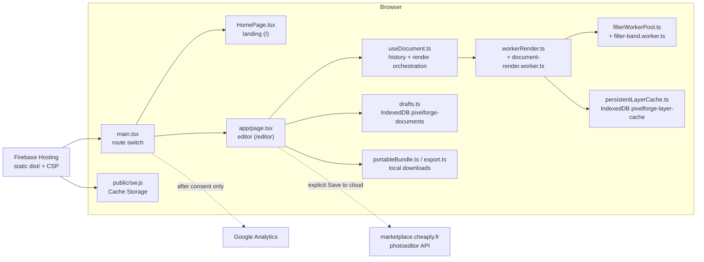
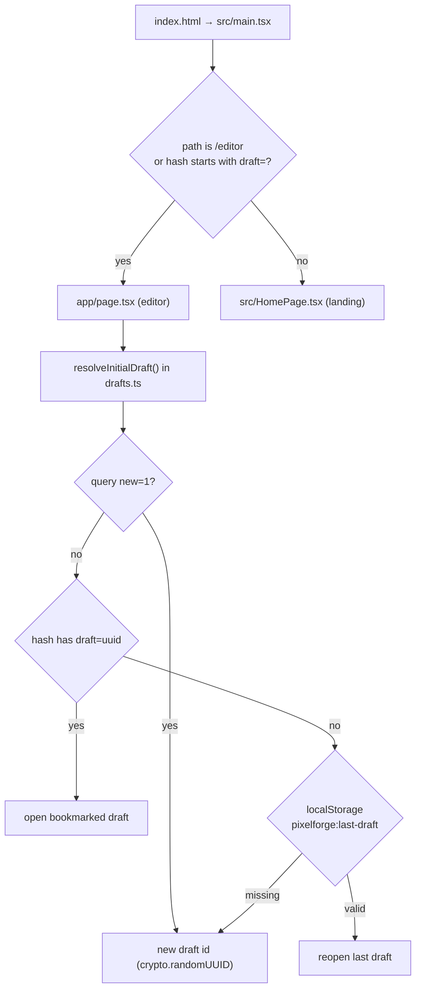
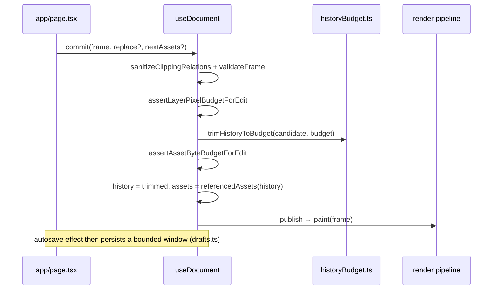
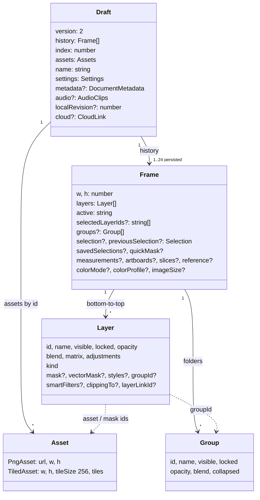
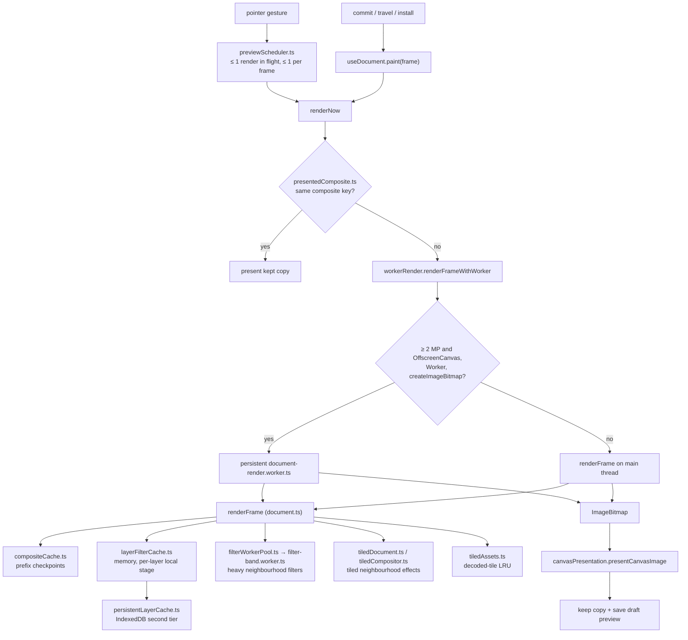
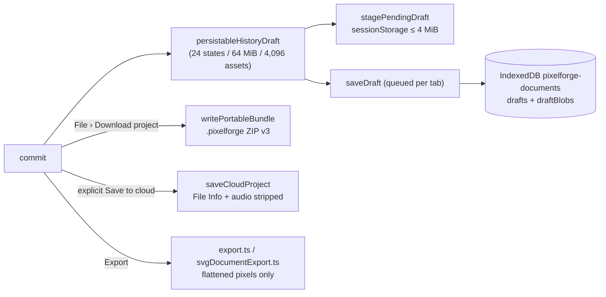

# PixelForge architecture

This is the system overview for developers. It explains how the pieces fit
together and points to the detailed contracts. Persisted byte layouts live in
[`data-formats.md`](./data-formats.md); build, test and release workflows are
in [`developer-guide.md`](./developer-guide.md), [`testing.md`](./testing.md)
and [`operations.md`](./operations.md). The documentation index is
[`README.md`](./README.md).

Source code is the authority. When a contract document and the code disagree,
the code wins; fix the document.

## Contents

- [System at a glance](#system-at-a-glance)
- [Repository layout](#repository-layout)
- [App shell and routing](#app-shell-and-routing)
- [Editor state and history](#editor-state-and-history)
- [Document model](#document-model)
- [Render pipeline](#render-pipeline)
- [Storage](#storage)
- [Service worker and offline](#service-worker-and-offline)
- [Analytics and consent](#analytics-and-consent)
- [Security model summary](#security-model-summary)
- [Module map of `src/`](#module-map-of-src)

## System at a glance

PixelForge is a static single-page application: Vite builds React 19 code into
`dist/`, Firebase Hosting serves it, and every editing operation runs in the
visitor's browser. There is no application server. The only network services
are optional: the Cheaply Marketplace API for signed-in cloud projects, and
Google Analytics after explicit consent.

Key properties:

- **Local-first.** Images, drafts, undo history and caches stay in the browser
  profile. Anonymous use is fully functional; nothing is uploaded unless the
  user picks a cloud action.
- **Pure core, thin edges.** About 300 modules in `src/` hold the domain logic.
  Most are pure TypeScript that Node tests import directly; browser APIs
  (canvas, IndexedDB, workers, network) sit at the edges.
- **Bounded everything.** Document size, layers, history, caches, imports and
  exports all have explicit limits (`src/projectLimits.ts`,
  `src/historyBudget.ts`, and per-feature constants). See
  [`performance-budgets.md`](./performance-budgets.md).

## Repository layout

| Path | Purpose |
| --- | --- |
| `app/page.tsx` | The editor component (about 25,000 lines): menus, tools, panels, dialogs, gesture handling, save/export orchestration. It composes the `src/` modules. |
| `app/globals.css` | Global editor styles (imported by `src/main.tsx`). |
| `src/` | Domain modules, React components, workers and styles; see the [module map](#module-map-of-src). |
| `components/ui/` | shadcn/Base UI primitives (`button.tsx`, `dialog.tsx`, `select.tsx`, …). Configured by `components.json`. |
| `hooks/use-mobile.ts` | `useIsMobile()` breakpoint hook (768 px) used by the UI primitives. |
| `lib/utils.ts` | `cn()` class-name helper (`clsx` + `tailwind-merge`). |
| `public/` | Static files copied verbatim: `sw.js` (service worker), `manifest.webmanifest`, icons, logos, `og.png`, and `fonts/` (the self-hosted font library, filled by `scripts/copy-fonts.mjs`). |
| `scripts/` | Build and release tooling: `write-release.mjs` and `release-version.mjs` (`/release.json`), `verify-deployment.mjs`, `build-help.mjs` (Help Center), `copy-fonts.mjs`, `sync-font-library.mjs`, `font-catalog.mjs`, `measure-*.mjs` performance probes, and `scripts/lib/`. |
| `help/` | Markdown sources of the Help Center, built to `dist/help/` by `scripts/build-help.mjs`. |
| `tests/` | Node unit tests (`tests/*.test.mjs`) and Playwright suites (`tests/browser/*.spec.ts`); see [`testing.md`](./testing.md). |
| `docs/` | Contracts, budgets and runbooks. |
| `firebase.json` | Hosting config: headers (CSP, caching), rewrites (`/editor`, `/health`, `/api/readyz`). |
| `vite.config.ts` | Vite config; bakes `__PIXELFORGE_BUILD_COMMIT__` and `__PIXELFORGE_BUILD_VERSION__` into the bundle. |

## App shell and routing

`index.html` loads `src/main.tsx`, which:

1. installs the auto-hiding scrollbar handlers (`src/scrollbarActivity.ts`);
2. picks the page: the editor (`app/page.tsx`) when `location.pathname` is
   `/editor` **or** the hash starts with `#draft=`; otherwise the landing page
   (`src/HomePage.tsx`);
3. always mounts `src/Analytics.tsx` (it does nothing until consent);
4. in production builds only, registers `/sw.js` with scope `/` after `load`.
   Registration failure is ignored; editing never depends on it.

There is no client-side router library. Firebase rewrites `/editor` to
`/index.html`; the Help Center is a separate set of static pages under `/help`
that work without the editor bundle. `rememberDraft()` keeps the URL at
`/editor#draft=<id>` (via `history.replaceState`) and records the id in
`localStorage`, so a bookmark or a plain `/editor` visit reopens the work.

## Editor state and history

### Ownership

`app/page.tsx` owns UI state (tool, options, dialogs, viewport) in React state
and refs. The document itself is owned by the `useDocument` hook
(`src/useDocument.ts`), which keeps three mutable refs outside React state so
large documents never pass through React reconciliation:

| Ref | Contents |
| --- | --- |
| `history.current` | `Frame[]`, the undo/redo stack of immutable document snapshots |
| `index.current` | position of the current frame in `history` |
| `assets.current` | `Assets` map (asset id → PNG data URL or tiled asset) referenced by any frame in `history` |
| `audio.current` | `AudioClips` referenced by frames (Audio Annotation tool) |

React sees only `frame` (the current snapshot) and a `revision` counter.

### History model

A history entry is a whole `Frame` (see [Document model](#document-model)).
Frames are immutable and cheap: pixels live in shared, immutable assets that
frames reference by id, so a layer rename or move adds a new small frame that
shares every asset with its predecessor. Raster edits add new assets (or, for
tiled assets, only the new tiles).

`useDocument` operations:

| Function | Effect |
| --- | --- |
| `commit(frame, replace = false, nextAssets?)` | Validates and appends a new entry after the current index (dropping redo entries). `replace = true` starts a new single-entry history (new or imported document, Purge History) and clears layer filter caches. On any error the previous state is restored and the message goes to `onError`. |
| `travel(direction)` | Undo (`-1`) / redo (`+1`): moves `index` and re-renders; no validation is needed because entries were validated on commit. |
| `amend(value, expected, dropPrevious, keep)` | Replaces the newest entry without adding an undo step (folds a pixel-identical paint-time layer expansion into the stroke). Refuses if `expected` is no longer current. |
| `restorePrevious(...)` | Replaces the entry just below the current one with a pixel-identical frame. |
| `select` / `setLayerSelection` | Layer selection changes overwrite the *current* entry in place; they do not create undo steps. |
| `install(draft)` | Opens a validated draft (reload, project file, cloud): verifies every history asset decodes, shows the saved preview if one exists, renders, then swaps in the draft's history, index and assets. |
| `paint` / `schedulePaint` / `cancelScheduledPaint` | Immediate render vs. coalesced live gesture preview (see [Preview scheduler](#preview-scheduler-and-presentation)). |

### History budgets (`src/historyBudget.ts`)

In-memory capacity is chosen once per tab from coarse, never-persisted hints
(`navigator.deviceMemory`, mobile user agent):

| Tier | Condition | Max states | Retained image bytes |
| --- | --- | --- | --- |
| `desktop` | not mobile, memory unknown or > 4 GB | 240 (`HISTORY_MAX_STEPS`) | 320 MiB (`HISTORY_DESKTOP_BYTES`) |
| `standard` | mobile, or `deviceMemory` ≤ 4 | 240 | 128 MiB (`HISTORY_STANDARD_BYTES`) |
| `low-memory` | `deviceMemory` ≤ 2 | 240 | 96 MiB (`HISTORY_LOW_MEMORY_BYTES`) |

Bytes are encoded asset bytes: the data-URL length of each PNG asset, plus the
base64 PNG length of each *distinct* tile of tiled assets (shared tiles count
once). `trimHistoryToBudget` always keeps the current frame, drops the oldest
undo states first, and drops redo states (farthest first) only once every undo
state is gone.

Separately, each edit is checked against the per-device **project** budget in
`src/projectLimits.ts` (stored layer pixels and referenced asset bytes for the
current frame; 1,024 MP / 1 GiB on desktop down to 128 MP / 128 MiB on
low-memory devices). An edit that does not grow the document is always
allowed, so a large project opened on a smaller device is never stranded.

Persistence uses a *smaller* window than memory: `selectPersistedHistory`
keeps the current frame plus neighbours, alternating undo/redo nearest first,
within 24 states (`DRAFT_HISTORY_MAX_STEPS`), 64 MiB of referenced images
(`DRAFT_HISTORY_MAX_BYTES`) and 4,096 distinct assets
(`DRAFT_HISTORY_MAX_ASSETS = MAX_PROJECT_ASSETS`). The current frame is always
persisted even if it alone exceeds 64 MiB (up to the 1 GiB format ceiling).
States outside the window stay in memory only; the History panel says so via
`persistedHistoryNote`. Details: [`data-formats.md`](./data-formats.md#persisted-history-window).

## Document model

The document model is defined in `src/document.ts` (types, validation,
rendering) with persistence wrappers in `src/drafts.ts`. The legacy prose
reference is [`layer-document-format.md`](./layer-document-format.md).

### Frame

A `Frame` is one complete document state: canvas size `w × h`, the ordered
layer stack (index 0 is the bottom), the active layer id and selection, plus
optional metadata. Optional fields were added over time; validation treats a
missing field as the legacy default (for example `imageSize` → 72 ppi,
`colorMode` → RGB, `colorProfile` → sRGB, `selectedLayerIds` → `[active]`).

### Layer kinds

`Layer` is a discriminated union on `kind`. Every layer shares the `Common`
fields (`id`, `name`, `visible`, `locked`, `opacity`, `blend`, affine
`matrix`, `adjustments`, and optional `styles`, `mask`/`maskEnabled`/
`maskInverted`, `vectorMask`, `groupId`, `spotHealing`, `patchStrokes`,
`contentAwareFills`/`Moves`/`Scales`, `matting`, `smartFilters`,
`clippingTo`, `layerLinkId`).

| `kind` | Kind-specific fields | Notes |
| --- | --- | --- |
| `raster` | `asset`, `fillColor?`, `background?: true` | Pixel layer. Paint layers are stored at their content bounds and positioned by `matrix` ([`layer-pixel-budget-contract.md`](./layer-pixel-budget-contract.md)). `background` marks a Photoshop-style Background. |
| `smart-object` | `asset`, `sourceName?`, `linkId?`, `contents?: Frame` | Source-retaining embedded raster; `contents` is a nested editable document, bounded by `MAX_NESTED_SMART_OBJECT_DEPTH = 4`. |
| `adjustment` | none beyond `Common` | Source-free correction applied to the composite below it. |
| `text` | `text`, `color`, `fontSize`, `fontFamily`, `bold`, `boxWidth`, `textAlign`, `lineHeight`, `letterSpacing`, `orientation`, plus optional `warp`, `textPath`, `openType`, `languageOptions`, `textMode`, `boxHeight`, `rich`, `paragraph`, `antiAlias`, `fit` | Rendered from properties; never flattened unless the user rasterizes. See [`type-tool-contract.md`](./type-tool-contract.md). |
| `rectangle` | `width`, `height`, `color`, `stroke`, `fill`, `strokeColor?`, `cornerRadius?` | Parametric shape. |
| `ellipse` | `width`, `height`, `color`, `stroke`, `fill`, `strokeColor?` | Parametric shape. |
| `line` | `width`, `height`, `color`, `stroke` | Segment from the layer origin to (`width`, `height`). |
| `polygon` | `width`, `height`, `color`, `stroke`, `fill`, `strokeColor?`, `sides` (3–32), `variant?`, `innerRadius?` | Polygon, triangle or star. |
| `path` | `path: PathModel` | Editable Pen path (`src/paths.ts`). |

Helper predicates: `isRasterContentLayer` (`raster`, `smart-object`),
`isMaskableLayer` (adds `adjustment`), `isVectorMaskableLayer` (every kind
except `adjustment`).

### Groups

`Group` (`id`, `name`, `visible`, `locked`, `opacity`, `blend`, `collapsed`) is
folder metadata. Layers join a group through `groupId`; their order stays in
`Frame.layers`. Groups render into an isolated surface
([`group-compositing-contract.md`](./group-compositing-contract.md)).

### Assets

`Assets` is `Record<string, Asset>` keyed by UUID, stored once per draft and
shared by all frames:

- `PngAsset` — `{ url: 'data:image/png;base64,…', w, h }`.
- `TiledAsset` — `{ w, h, tileSize: 256, tiles: (AssetTile | null)[] }`, a
  row-major grid of immutable, content-addressed PNG tile Blobs. Canvases of at
  least `TILED_ASSET_MIN_PIXELS` (1024 × 1024) are stored tiled by `addAsset`.
  See [`tiled-layer-assets-contract.md`](./tiled-layer-assets-contract.md).

Every asset is at most 16,000 px per side and 16 MP. Masks, Quick Mask and
colour-range selections are also assets. `referencedAssets(history, assets)`
is the garbage collector: after each commit only assets some frame still
references are kept.

### Hard limits

| Limit | Value | Source |
| --- | --- | --- |
| Layers per frame | 512 | `MAX_DOCUMENT_LAYERS` |
| Groups per frame | 128 | `MAX_DOCUMENT_GROUPS` |
| Distinct assets per draft/project | 4,096 | `MAX_PROJECT_ASSETS` |
| Stored layer pixels (format ceiling) | 1,024,000,000 | `LAYER_PIXEL_CEILING` |
| Referenced PNG bytes (format ceiling) | 1 GiB | `PROJECT_ASSET_BYTES_CEILING` |
| New document | 16,000 px side, 16 MP | `src/newDocument.ts` |
| Draft name | 160 characters | `validateDraft` |

## Render pipeline

Rendering turns a `Frame` plus `Assets` into pixels on the visible canvas. The
core compositor is `renderFrame` in `src/document.ts`; it runs either inside a
dedicated worker or on the main thread with identical output. Contracts:
[`worker-render-contract.md`](./worker-render-contract.md),
[`tiled-layer-assets-contract.md`](./tiled-layer-assets-contract.md),
[`performance-budgets.md`](./performance-budgets.md).

### Worker render (`src/workerRender.ts`)

- Frames of at least 2,000,000 pixels (`WORKER_MIN_PIXELS`) render in a
  persistent module worker (`src/document-render.worker.ts`) when the browser
  has `Worker`, `OffscreenCanvas` and `createImageBitmap`
  (`canRenderInWorker`). Smaller frames, or browsers without those APIs, use
  the main-thread `renderFrame` fallback.
- The worker is reused across renders and released after 5 minutes idle
  (`PERSISTENT_WORKER_IDLE_MS`). A superseded request never publishes into a
  newer one (sequence numbers and `AbortSignal`).
- `src/workerAssets.ts` mirrors which encoded assets the worker already holds
  (by content fingerprint), so a render posts only new assets. If the mirror is
  wrong the worker reports missing assets and the request is resent in full.
- A watchdog (`renderWatchdogBudget`) bounds render time by layer count and
  megapixels and restarts on progress messages.

### Caches

| Cache | Module | Scope | Key / bound |
| --- | --- | --- | --- |
| Prefix composite checkpoints | `compositeCache.ts` | per render context (worker or main) | Snapshots below the active / lowest changed layer; used for stacks of ≥ 8 layers (`COMPOSITE_CACHE_MIN_LAYERS`). Keys use layer JSON and asset *content* fingerprints, never ids alone. Device-aware snapshot count. |
| Presented composite | `presentedComposite.ts` | main thread | One copy of the last presented composite of frames ≥ 2 MP with ≥ 8 layers (none on low-memory devices), keyed by `compositeEquivalenceKey`; edits that cannot change a pixel (rename, empty layer, reselect) re-present it without rendering. |
| Layer filter cache | `layerFilterCache.ts` | worker and main | Finished layer-local stage (source → healing/patch → content-aware → matting → Smart Filters → Filter Effect → styles). 256 MiB desktop, 512 MiB with large memory, 96 MiB mobile, 32 MiB low-memory. |
| Persistent layer cache | `persistentLayerCache.ts` | IndexedDB `pixelforge-layer-cache` | Lossless PNGs of expensive filtered layers and the draft's reopen preview (`pixelforge:presented-latest` slot). 1 GiB desktop, 256 MiB mobile, disabled on low-memory devices. LRU; any failure is a miss. |
| Decoded tiles | `tiledAssets.ts` | per context | `ImageBitmap`s of tiles, LRU by RGBA bytes: 96 / 192 / 32 / 12 MiB by device tier. |
| Decoded assets | `document.ts` | per context | 16–64 MP of decoded PNG assets depending on device (`decodedAssetBudgetForDevice`). |
| Tiled render cache | `tilePlan.ts` `TileCache` + `tileCachePolicy.ts` | per `useDocument` | 2–16 MiB (default 8 MiB), keyed by document revision. |

### Heavy filters and tiling

- `src/filterWorkerPool.ts` runs heavy neighbourhood filters (blurs, etc.) in
  parallel row bands (`src/filterBands.ts`) or tiles on layers of at least
  512 Ki pixels (`FILTER_PARALLEL_MIN_PIXELS`). Pool size follows
  `navigator.hardwareConcurrency`, capped at 8 on desktop and 2 on phones
  (`FILTER_WORKERS_MAX_DESKTOP` / `_MOBILE`). Workers
  (`src/filter-band.worker.ts`) are stateless; a worker failure falls back to
  the synchronous kernels (`src/fastNeighborhoodFilters.ts`) with identical
  output. The pool can be created from the main thread or nested inside the
  render worker.
- `src/tiledDocument.ts` holds the allow-list of radius-bounded,
  translation-invariant effects that may render tile by tile; `tiledCompositor.ts`
  renders each expanded tile and writes back only its inner rectangle;
  `tilePlan.ts` bounds tile plans (64–1024 px tiles, ≤ 4,096 tiles, 16 MiB
  default / 64 MiB maximum batch bytes). `tiledRender.ts` is a versioned
  planning envelope (`TILED_RENDER_PROTOCOL_VERSION = 1`).
- `src/image-encode.worker.ts` (driven by `src/workerEncode.ts`) encodes PNGs
  off the main thread with `OffscreenCanvas` where supported.

### Preview scheduler and presentation

Painting tools stamp into a gesture buffer synchronously on every pointer
event, so no input is lost. Compositing that buffer into the document is
expensive, so `src/previewScheduler.ts` keeps at most one preview render in
flight and starts at most one per animation frame, always for the newest
buffer. Any explicit render (commit, undo, install) cancels a pending preview
so a stale gesture can never paint over a newer state.
`src/canvasPresentation.ts` presents finished images flash-free, resizing the
backing store only when the document size changed.

After a render of a large document is presented, a copy is kept
(`PresentedComposite`) and, after 3 s of quiet (`DRAFT_PREVIEW_DELAY_MS`, or
immediately when the page is hidden), saved to the persistent layer cache as
the draft's reopen preview. On reopen, if the stored preview's tag matches the
draft's composite key, it is shown at once and the layers render in the
background (`warm`) to fill the worker caches.

## Storage

| Layer | Module | Trigger | Notes |
| --- | --- | --- | --- |
| Local draft | `src/drafts.ts`, `src/draftAssetStore.ts`, `src/draftBundle.ts` | Automatic after each change; **Save draft** re-runs it immediately | IndexedDB `pixelforge-documents` v2, content-addressed asset records, one atomic transaction per save, optimistic `localRevision` check across tabs, shared Web Lock `pixelforge:draft-open:<id>`. Contract: [`draft-storage-contract.md`](./draft-storage-contract.md). |
| Write-ahead snapshot | `src/drafts.ts` | Before each IndexedDB save | `sessionStorage` `pixelforge:pending-draft:<id>`, ≤ 4 MiB, tab-scoped; closes the reload window. |
| Project file | `src/portableBundle.ts` | User downloads/opens a project | `.pixelforge` store-only ZIP, version 3. Contract: [`portable-project-bundle-contract.md`](./portable-project-bundle-contract.md). |
| Cloud project | `src/cloud.ts` | Signed-in user chooses Save / Update / Open | Never automatic. `stripPrivateMetadata` removes File Info and audio before upload. Contracts: [`cloud-conflict-contract.md`](./cloud-conflict-contract.md), [`cheaply-auth-optional.md`](./cheaply-auth-optional.md). |
| Image export | `src/export.ts` and friends | User exports | Rendered pixels only; no source metadata. Contract: [`export-contract.md`](./export-contract.md). |

All persisted shapes, limits and migrations are documented in
[`data-formats.md`](./data-formats.md).

### Cloud save is explicit

`useMember()` polls `?action=session` (on mount and window focus) only to show
account state; failure leaves editing available. A document is sent only from
an explicit user action (`saveToCloud` in `app/page.tsx`), which sends
`cloudDocumentValue()`: the persisted history window, tiled assets flattened to
PNG, with `metadata` and audio annotations removed. Conflicts (`409`) raise
`CloudConflictError` and never replace local edits automatically.

## Service worker and offline

`public/sw.js` (registered only in production) keeps the shell usable offline
after one successful online visit. Contract: [`offline-pwa.md`](./offline-pwa.md).

| Request | Strategy | Cache |
| --- | --- | --- |
| Non-GET or cross-origin (Marketplace API, analytics) | not intercepted | none |
| `/release.json`, `/api/readyz.json`, `/api/readyz`, `/health` | not intercepted (always network) | none |
| `/fonts/**` | cache first, fill on first use | `pixelforge-fonts-v1` |
| Navigations under `/help` | network first, fall back to cached page, then `/help` | `pixelforge-shell-v3` |
| Other navigations | network first; success refreshes `/index.html`; offline returns cached `/index.html` | `pixelforge-shell-v3` |
| Other same-origin GETs (hashed Vite assets) | cache first, fill on first success | `pixelforge-shell-v3` |

Install pre-caches `/`, `/index.html`, `/manifest.webmanifest`,
`/favicon.svg`, `/pixel-logo.svg` and the 192/512 px icons. Activation deletes
older `pixelforge-shell-*` caches. Bump `CACHE_NAME` when the cache contract
changes. Drafts are in IndexedDB, not in the service worker cache.

## Analytics and consent

`src/Analytics.tsx` is inert unless the build sets a valid GA4 id
(`VITE_CHEAPLY_GA_MEASUREMENT_ID`, `G-…`). Then:

- With no stored choice it shows a small non-modal consent region
  (`#cheaply-analytics-consent`) with **No thanks** / **Allow**.
- The choice is stored in `localStorage` key `cheaply.analytics.consent.v1`
  (`granted` | `denied`). Other Cheaply surfaces can set it through the
  `cheaply:analytics-consent` window event or `window.cheaplyAnalytics`.
- Only after `granted` does it load `gtag.js`, with ad storage and
  personalization denied, Google signals off, and a single `page_view`
  carrying `app_name: 'cheaply-pixelforge'` and the page *origin* (no path,
  hash or draft id).

See [`analytics.md`](./analytics.md) and
[`security-and-privacy.md`](./security-and-privacy.md).

## Security model summary

The full model is in [`security-and-privacy.md`](./security-and-privacy.md).
In brief:

- **CSP** (`firebase.json`): `default-src 'self'`; scripts only from self and
  `www.googletagmanager.com`; `img-src`/`media-src` allow `data:` and `blob:`
  (assets are data URLs and Blobs); `connect-src` limited to self, the
  Marketplace API and Google Analytics endpoints; `object-src 'none'`;
  `frame-ancestors 'self' https://*.cheaply.fr`. Also `nosniff`,
  `strict-origin-when-cross-origin` referrer policy, and a Permissions-Policy
  that disables camera and geolocation and allows the microphone for self
  (Audio Annotation recording).
- **Untrusted input is validated before use.** Drafts, project files and cloud
  responses all pass `validateDraft`; portable bundles verify ZIP structure,
  CRC-32 and SHA-256 per entry; draft records are hash-verified on read.
- **SVG import** is sanitised by `src/svg.ts` (`prepareSvgImport`: conservative
  subset, no scripts, event handlers, external references or foreign content;
  8 MiB, 20,000 elements, 16 MP) before `src/svgImport.ts` converts it to
  layers; unsupported parts are rasterized from a self-contained SVG.
- **Other importers** (`src/psd.ts`, `src/tiff.ts`, `src/pdf.ts`) are bounded
  composite decoders (64 MiB input) that read pixels only.
- **Exports carry pixels only.** Images are encoded from a rendered canvas, so
  EXIF/GPS and source profiles are never copied. File Info (`src/metadata.ts`)
  stays in the local draft and project file and is stripped from cloud
  payloads ([`metadata-privacy-contract.md`](./metadata-privacy-contract.md)).
- **Local-first privacy.** Images never leave the device except through an
  explicit cloud save by a signed-in user; device-memory hints used for budgets
  are never persisted or sent.

## Module map of `src/`

Every file in `src/` is listed once, grouped by responsibility. Line counts
change often; the purpose column is what matters. `*.tsx` files are React
components; `*.worker.ts` files are worker entry points; most `*.ts` files are
pure and unit-tested from `tests/*.test.mjs`.

### App shell, landing and chrome

| Files | Purpose |
| --- | --- |
| `main.tsx` | Entry point: route switch, analytics mount, service-worker registration. |
| `HomePage.tsx`, `LandingHeroDemo.tsx`, `landingContent.ts`, `home.css`, `landing.css` | Public landing page at `/`, its animated canvas demo, copy and styles. |
| `Brand.tsx` | Cheaply × PixelForge lockup and footer. |
| `Analytics.tsx` | Consent-gated GA4 loader. |
| `AccountMenu.tsx` | Sign-in/out links to the Marketplace session, account avatar (guest seed in `localStorage`). |
| `ReleaseStatusView.tsx`, `releaseStatus.ts` | Top-bar build version and `/release.json` / `/api/readyz.json` health polling ("Offline · local editing"). |
| `scrollbarActivity.ts` | Auto-hiding thin scrollbars ([`scrollbar-contract.md`](./scrollbar-contract.md)). |
| `useDelayedFlag.ts`, `performanceMarks.ts` | Debounced boolean hook; optional `performance.mark` spans for profiling. |

### Document model, history and project limits

| Files | Purpose |
| --- | --- |
| `document.ts` | Core types (`Frame`, `Layer`, `Group`, `Selection`, `Assets`), validation (`validateFrame`, `validAsset`), asset management (`addAsset`, `referencedAssets`, `flattenTiledAssets`), decoded-asset cache and the compositor `renderFrame`. |
| `useDocument.ts` | React hook owning history, assets, render orchestration, draft preview and install. |
| `projectLimits.ts` | Format ceilings and per-device edit budgets. |
| `historyBudget.ts`, `historyPurge.ts`, `historyTimeline.ts`, `HistoryPanel.tsx`, `PurgeHistoryDialog.tsx` | Undo/redo budgets and persisted window, Purge History, privacy-safe step labels, History panel UI. |
| `newDocument.ts`, `NewDocumentDialog.tsx` | File › New presets and bounds. |
| `imageSize.ts`, `ResizeDialog.tsx`, `canvasSize.ts`, `CanvasSizeDialog.tsx`, `TrimDialog.tsx` | Image Size, Canvas Size, Trim and Reveal All geometry and dialogs. |
| `colorMode.ts`, `colorProfile.ts`, `ColorProfileDialog.tsx`, `ColorSettingsDialog.tsx` | Grayscale working mode, sRGB/Display P3 profile labels and conversion. |
| `metadata.ts`, `MetadataDialog.tsx` | File Info (title/description/author), local and project only. |
| `measurements.ts`, `referenceImage.ts`, `ReferencePanel.tsx` | Ruler/count/note/sampler overlays; reference (guide) image overlay. |
| `artboards.ts`, `artboardFit.ts`, `artboardRender.ts`, `slices.ts` | Named artboards/viewports and slices, fitting and viewport rendering. |
| `audioAnnotations.ts`, `audioAnnotationPanel.tsx` | Bounded local audio notes pinned to the canvas. |

### Layers and compositing

| Files | Purpose |
| --- | --- |
| `blendModes.ts`, `groupCompositing.ts`, `layerClipping.ts` | Blend modes, isolated group compositing, clipping masks. |
| `layerAlignment.ts`, `layerArrange.ts`, `layerDragReorder.ts`, `layerInsertion.ts`, `LayerPositionDialog.tsx` | Align/distribute, arrange, drag-and-drop, insertion planning. |
| `layerLinks.ts`, `linkedLayers.ts`, `layerLock.ts`, `layerOpacity.ts`, `layerSearch.ts`, `layerSelection.ts`, `layerPick.ts` | Linking, locking, opacity field, search, multi-selection, canvas picking. |
| `layerMerge.ts`, `layerMergeVisible.ts`, `layerRasterize.ts`, `layerTrim.ts` | Merge, Merge Visible, rasterize, content-bounds storage and expansion. |
| `layerStyles.ts` | Layer styles (shadows, glows, strokes, …). |
| `layerThumbnails.ts`, `LayerThumbnail.tsx`, `LayersPanel.tsx`, `LayerTransformDialog.tsx` | Layers panel, lazy thumbnails, numeric transform. |
| `masks.ts`, `maskRefinement.ts`, `vectorMask.ts`, `matting.ts`, `smartFilters.ts` | Raster and vector masks, mask refinement, matting, Smart Filter stacks. |
| `applyImage.ts`, `fade.ts`, `FillLayerDialog.tsx`, `pasteSpecial.ts`, `PasteSpecialDialog.tsx`, `clipboardImage.ts` | Apply Image / Calculations, Fade, fill layers, Paste Special, OS clipboard images. |

### Render pipeline, workers and caches

| Files | Purpose |
| --- | --- |
| `workerRender.ts`, `document-render.worker.ts`, `workerAssets.ts` | Worker vs main-thread render, persistent render worker, asset reuse protocol. |
| `filterWorkerPool.ts`, `filter-band.worker.ts`, `filterBands.ts`, `fastNeighborhoodFilters.ts`, `alphaSpread.ts` | Parallel heavy filters and their fast kernels. |
| `image-encode.worker.ts`, `workerEncode.ts` | Off-main-thread PNG encoding. |
| `compositeCache.ts`, `presentedComposite.ts`, `layerFilterCache.ts`, `persistentLayerCache.ts` | Composite, presentation and filter caches (memory and IndexedDB). |
| `tiledAssets.ts`, `tiledDocument.ts`, `tiledRender.ts`, `tiledCompositor.ts`, `tilePlan.ts`, `tileCachePolicy.ts` | Tiled assets, tiled effects, tile planning and cache budgets. |
| `previewScheduler.ts`, `canvasPresentation.ts`, `canvasDirty.ts` | Live-preview coalescing, flash-free presentation, dirty rectangles. |

### Persistence and interchange

| Files | Purpose |
| --- | --- |
| `drafts.ts` | `Draft`/`Settings` types, `validateDraft` + migrations, IndexedDB save/read/discard, write-ahead snapshots, draft ids and Web Locks. |
| `draftAssetStore.ts`, `draftBundle.ts` | Draft storage formats 3/4 (content-addressed) and legacy format 2 (chunked). |
| `draftSaveStatus.ts` | Save draft / Duplicate draft wording. |
| `portableBundle.ts` | `.pixelforge` v3 ZIP writer/reader. |
| `cloud.ts`, `ProjectLibrary.tsx` | Optional cloud API client, response validation, project library UI. |
| `download.ts` | Blob downloads and Save-with-file-picker. |

### Import

| Files | Purpose |
| --- | --- |
| `importFormats.ts` | Format classification and honest capability messages (raster, HEIC, TIFF, SVG, PDF, PSD, RAW). |
| `psd.ts`, `tiff.ts`, `pdf.ts` | Bounded composite decoders. |
| `svg.ts`, `svgImport.ts`, `svgImportLayers.ts` | SVG sanitising, SVG → editable layers plan, browser half of SVG import. |

### Export

| Files | Purpose |
| --- | --- |
| `export.ts`, `ExportDialog.tsx` | PNG/JPEG/WebP/PSD/PDF encode, target-size search, ZIP writer, export dialog (also layered SVG). |
| `psdExport.ts`, `pdfExport.ts` | Flattened PSD and single-page PDF encoders. |
| `svgDocumentExport.ts`, `svgExport.ts`, `cssExport.ts` | Layered SVG export; single path → SVG; layer → CSS (clipboard). |
| `batch.ts`, `BatchExportDialog.tsx`, `imageBatch.ts`, `ImageBatchDialog.tsx` | History batch export and multi-input image batch export (ZIP + manifest). |

### Adjustments and filters

| Files | Purpose |
| --- | --- |
| `AdjustmentsDialog.tsx`, `auto.ts`, `colorBalance.ts`, `curves.ts`, `CurveEditor.tsx`, `hue.ts`, `photoAdjustments.ts`, `CameraRawDialog.tsx`, `sharpenNoise.ts` | Nondestructive adjustments: auto tone, colour balance, curves, hue, photo/Camera Raw controls, sharpen and noise. |
| `histogram.ts`, `HistogramDialog.tsx` | Histogram. |
| `filterEffects.ts`, `filterActionParameters.ts`, `filterCenter.ts`, `filterRegion.ts`, `lastFilter.ts` | Filter menu effects, their parameters, centres, selection-bounded regions, Last Filter. |
| `FilterGalleryDialog.tsx`, `BlurGalleryControls.tsx`, `LightRaysControls.tsx`, `lightRays.ts`, `deinterlace.ts` | Filter Gallery, Blur Gallery, Light Rays, De-Interlace. |
| `perspectiveWarp.ts`, `puppetWarp.ts` | Perspective and Puppet Warp approximations. |

### Selections

| Files | Purpose |
| --- | --- |
| `selections.ts`, `selectionBounds.ts`, `selectionClip.ts`, `selectionComposition.ts`, `selectionEmpty.ts`, `selectionOutline.ts`, `selectionPolygon.ts` | Selection rendering, bounds, edit clipping, composition, empty selections, marching ants, lasso bounds. |
| `selectionBrush.ts`, `selectionFeather.ts`, `selectionRefine.ts`, `selectionSnapshotCache.ts` | Selection brush, feather, refine, cached masks for healing/patch. |
| `savedSelections.ts`, `SaveSelectionDialog.tsx`, `SelectAndMaskDialog.tsx`, `SelectionFeatherDialog.tsx`, `SelectionModifyDialog.tsx`, `SelectionTransformDialog.tsx` | Saved selections (`.pixelselection`) and selection dialogs. |
| `colorRange.ts`, `ColorRangeDialog.tsx`, `colorRegion.ts`, `similarSelection.ts` | Colour-based selection and Magic Wand / Fill region matching. |
| `magneticLasso.ts`, `quickSelection.ts`, `objectSelection.ts`, `assistedSelection.ts`, `focusArea.ts`, `FocusAreaDialog.tsx`, `marqueeOptions.ts` | Lasso, Quick/Object/Subject/Sky selection, Focus Area, marquee options. |
| `textMask.ts` | Type Mask selections. |

### Painting and retouching

| Files | Purpose |
| --- | --- |
| `brush.ts`, `brushBlend.ts`, `brushBristle.ts`, `brushBuildUp.ts`, `brushDual.ts`, `brushDynamics.ts`, `brushPressure.ts`, `brushSecondary.ts`, `brushSize.ts`, `brushSmoothing.ts`, `brushStrands.ts`, `brushTexture.ts`, `brushWetEdges.ts` | Brush engine and its options. |
| `brushPresets.ts`, `brushPresetLibrary.ts`, `BrushPresetLibraryControls.tsx`, `customBrushPresets.ts` | Built-in and user brush presets. |
| `erasers.ts`, `mixerHistoryBrush.ts`, `smudge.ts`, `SmudgeToolOptions.tsx`, `tonal.ts`, `retouch.ts`, `colorReplace.ts`, `redEye.ts` | Erasers, Mixer/History/Art History brushes, Smudge, Dodge/Burn/Sponge, Blur/Sharpen brush, Color Replacement, Red Eye. |
| `paintSymmetry.ts`, `PaintSymmetryControls.tsx` | Paint Symmetry. |
| `retouchOptions.ts`, `spotHealing.ts`, `patchTool.ts`, `patternStamp.ts`, `imagePatterns.ts`, `customPatternPresets.ts` | Clone/Pattern Stamp, Spot Healing, Patch. |
| `contentAwareCleanup.ts`, `contentAwareMove.ts`, `contentAwareScale.ts`, `backgroundRemoval.ts` | Content-aware fill/move/scale and background removal (local approximations). |
| `editFill.ts`, `EditFillDialog.tsx`, `strokeSelection.ts`, `StrokeSelectionDialog.tsx` | Edit › Fill and Edit › Stroke Selection. |
| `gradientBlend.ts`, `gradientDither.ts`, `gradientNoise.ts`, `gradientPreview.ts`, `gradientShapes.ts`, `gradientStops.ts` | Gradient tool. |
| `strokeLifecycle.ts`, `strokeWindow.ts`, `pointerSamples.ts` | Stroke start/end rules, windowed pixel access, coalesced pointer samples. |

### Vectors, shapes and paths

| Files | Purpose |
| --- | --- |
| `paths.ts`, `pathBooleans.ts`, `pathEditTools.ts`, `penOptions.ts`, `curvaturePen.ts`, `freeformPen.ts` | Pen path model, booleans, anchor editing, pen tools. |
| `vectorShapes.ts`, `shapeAppearance.ts`, `customShapeLibrary.ts`, `customShapePresets.ts`, `customPathPresets.ts`, `cookieCutter.ts` | Parametric shapes, shape options, Custom Shape library and presets, Cookie Cutter. |
| `strokePath.ts`, `StrokePathDialog.tsx`, `alphaContours.ts` | Stroke Path with Brush; alpha → contour tracing. |

### Type and fonts

| Files | Purpose |
| --- | --- |
| `richText.ts`, `textSession.ts`, `useTypeTool.ts`, `TypeEditorOverlay.tsx`, `TypePanels.tsx`, `typeCommitTool.ts`, `textSidebarFields.ts`, `textSectionReveal.ts` | Rich-text model and layout, on-canvas editing session, Type tool controller and panels. |
| `typePresets.ts`, `typeStyles.ts`, `textBatch.ts`, `textReplace.ts`, `TextReplaceDialog.tsx`, `UpdateTextLayersDialog.tsx` | Type presets/styles, batch updates, find and replace. |
| `textWarp.ts`, `textOnPath.ts`, `openType.ts`, `textLanguage.ts`, `LanguageOptionsDialog.tsx`, `spellcheck.ts`, `SpellcheckDialog.tsx` | Warp, text on path, OpenType flags, language/direction, spellcheck. |
| `fontLibrary.ts`, `fontLibrary.generated.ts`, `fontLoader.ts`, `fontAvailability.ts`, `fontPreview.ts`, `useFontLibrary.ts`, `FontFamilySelect.tsx`, `FontPicker.tsx`, `MissingFontsDialog.tsx` | Self-hosted font library (generated catalogue), on-demand loading, favourites/recents, pickers. |
| `glyphIndex.ts`, `glyphInsert.ts`, `GlyphsPanel.tsx` | Glyphs panel. |

### Crop, view and navigation

| Files | Purpose |
| --- | --- |
| `cropOptions.ts`, `cropTools.ts` | Crop, Perspective Crop and Slice geometry. |
| `viewZoom.ts`, `viewRotation.ts`, `navigationOptions.ts`, `screenModes.ts` | Zoom, view rotation, navigation/sampling options, screen modes. |

### Generative-style tools (offline approximations)

| Files | Purpose |
| --- | --- |
| `generateImage.ts`, `GenerateImageDialog.tsx`, `GenerativeFillDialog.tsx`, `generativeUpscale.ts`, `GenerativeUpscaleDialog.tsx`, `promptToEdit.ts`, `PromptToEditDialog.tsx` | Bounded, deterministic local stand-ins; no model or network calls. |

### Workspace: toolbar, sidebar, menus, shortcuts, presets, actions

| Files | Purpose |
| --- | --- |
| `toolPalette.ts`, `toolIcons.ts`, `ToolFlyout.tsx`, `toolFamilyChoices.ts`, `toolbarPreferences.ts`, `ToolbarSettingsDialog.tsx` | Tool families, icons, flyouts, toolbar preferences. |
| `toolShortcuts.ts`, `commandShortcuts.ts`, `KeyboardShortcutsDialog.tsx`, `CommandSearchDialog.tsx`, `menuPreferences.ts`, `MenuSettingsDialog.tsx` | Shortcuts, command search, menu preferences. |
| `sidebarPanels.ts`, `sidebarSections.ts`, `SidebarSection.tsx`, `sidebarAutoScroll.ts`, `sidebarAutoScrollDom.ts`, `sidebarScrollMath.ts`, `useSidebarAutoScroll.ts` | Contextual properties sidebar and its auto-scroll. |
| `toolPresets.ts`, `ToolPresetsControl.tsx` | Named per-tool option presets (device-local, importable/exportable JSON). |
| `actions.ts`, `ActionsPanel.tsx`, `batchActions.ts` | Recorded Actions and batch application. |
