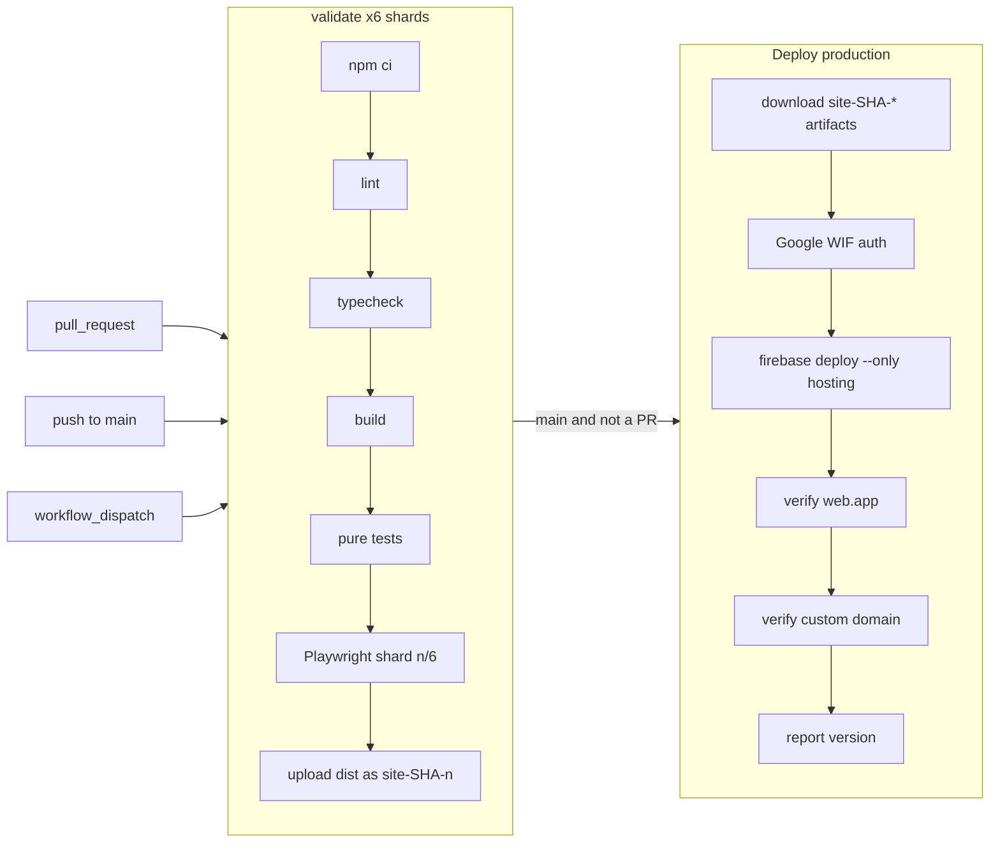

# Release and operations runbook

This is the day-to-day runbook for shipping, verifying, rolling back and
watching PixelForge in production. Infrastructure facts (Google project,
Workload Identity provider, DNS, cloud-storage backend) live in
[`deployment.md`](deployment.md); the security model lives in
[`security-and-privacy.md`](security-and-privacy.md). See the
[docs index](README.md) for everything else.

| Item | Value |
| --- | --- |
| Repository | `cheaply-fr/pixelforge-photo-editor` (public) |
| Workflow | `.github/workflows/ci-cd.yml`, named **CI and deploy** |
| Production URL | `https://photoeditor.cheaply.fr` (custom domain) |
| Hosting origin | `https://photoeditor-cheaply.web.app` (Firebase Hosting site `photoeditor-cheaply`) |
| Release identity | `/release.json` |
| Readiness probe | `/api/readyz.json` (also served as `/health` and `/api/readyz` by `firebase.json` rewrites) |
| Deploy tool | `firebase-tools` pinned in `package.json` devDependencies, run with `npx firebase` |

Keep four kinds of evidence distinct in every report: **local** (your
machine), **CI** (the Actions run), **deployment** (the deploy job and its
verifier) and **live functional** (someone exercising the feature on the
production URL). A green deploy proves the commit is served; it does not prove
a feature works.

## 1. Branch and pull-request flow

1. Branch from the current `origin/main` (`feat/…`, `fix/…`, `perf/…`,
   `docs/…`). Never push directly to `main`.
2. Validate locally on Node 22.13+ (see [`developer-guide.md`](developer-guide.md)
   and [`testing.md`](testing.md)):

   ```sh
   npm ci
   npm run lint
   npm run typecheck
   npm run build
   npm test
   npm run test:e2e
   ```

3. Open a pull request. The `pull_request` trigger runs the six
   `Validate editor (n/6)` shards.
4. Merge only when **all six shards are green** and review conversations are
   resolved.
5. The merge commit is pushed to `main`, which runs validation again and then
   **Deploy production**.

### What `main` branch protection actually enforces

Checked with `gh api repos/cheaply-fr/pixelforge-photo-editor/branches/main/protection`
(re-check before relying on it):

| Rule | Setting |
| --- | --- |
| Pull request required | Yes, 0 required approvals, stale reviews dismissed |
| Branch must be up to date before merge (`strict`) | Yes |
| Named required status checks | **None configured** (`contexts: []`, `checks: []`) |
| Conversation resolution required | Yes |
| Applies to admins | Yes |
| Force pushes / deletion | Blocked |
| Rulesets | None |

Because no status check is named as required, GitHub will let a PR merge with
a red or still-running `Validate editor` shard. The production deploy is still
gated (the `deploy` job `needs: validate` on the `main` run), so a broken
merge will not reach production, but it will block every later deploy until
`main` is fixed. Treat green shards as mandatory by convention.

> **Recommendation (not yet applied):** make this machine-enforced by adding
> the six `Validate editor (1/6)` … `Validate editor (6/6)` checks as required
> status checks in the `main` branch protection settings. Until a repository
> admin does so, the table above remains the current state.

The `production` GitHub environment only accepts deployments from the `main`
branch (custom branch policy `main`); it has no manual-approval reviewers.

## 2. CI pipeline



| Aspect | Behaviour (from `ci-cd.yml`) |
| --- | --- |
| Triggers | `pull_request` (any branch), `push` to `main`, manual `workflow_dispatch` |
| Workflow token | `permissions: contents: read`; the deploy job adds `id-token: write` only |
| Concurrency | Group `pixelforge-<ref>`, `cancel-in-progress: true` |
| Validate | Six-shard matrix, `fail-fast: false`, 25 min job timeout; pure tests capped at 10 min, each Playwright shard at 15 min with 2 workers |
| Analytics config check | Fails if repository variable `PIXELFORGE_GA_MEASUREMENT_ID` is set but not `G-…` |
| Artifacts | `site-<sha>-<shard>` (the `dist/` folder) kept 14 days; `browser-test-results-<shard>` (Playwright report and traces) on failure only, kept 7 days |
| Deploy condition | `needs: validate` and `github.ref == 'refs/heads/main'` and event is not `pull_request` |
| Deploy timeout | 15 min |
| Other scanners | GitHub CodeQL default setup runs on `main` pushes as a separate workflow; secret scanning and push protection are enabled on the repository |

**Concurrency caveat.** Runs are *not* queued. A newer push to `main` cancels
the in-flight `main` run, including a deploy job that has not finished. This
is visible as a `cancelled` **CI and deploy** run right before a newer merge.
The newest merge is still validated and deployed, and it contains the
cancelled commit, so nothing is lost, but **not every merge commit gets its
own production version**. Map a feature to a release by checking that the
deployed commit contains it (`git merge-base --is-ancestor <feature-sha> <deployed-sha>`).

**Artifact promotion.** The deploy job does not rebuild. It downloads all six
`site-<sha>-*` artifacts into one `dist/` (`merge-multiple: true`). Every shard
built the same commit in the same run, so hashed assets and the version are
identical; only `builtAt` can differ between files, because the last shard
artifact written wins per file. This is why `/release.json` and
`/api/readyz.json` may show slightly different `builtAt` values. The verifier
compares commit and version, not `builtAt`.

## 3. Deploy job

The deploy job runs only on `main` and publishes the tested artifact:

1. `npm ci` (needed for the pinned `firebase-tools` and the verifier).
2. Download the six `site-${{ github.sha }}-*` artifacts into `dist/`.
3. Authenticate with `google-github-actions/auth` through **Workload Identity
   Federation**. GitHub's OIDC token is exchanged for short-lived credentials
   for the dedicated deploy service account. No service-account key exists in
   GitHub. Provider and IAM details: [`deployment.md`](deployment.md#cicd).
4. `npx firebase deploy --only hosting --project photoeditor-cheaply --non-interactive`
   publishes `dist/` with the headers and rewrites in `firebase.json`.
5. `npm run verify:deployment` against the `web.app` origin, then against the
   custom domain (TLS is checked implicitly by HTTPS).
6. Print `Deployed v<version> (<commit>)` to the job summary.

Redeploy the current `main` with **Actions → CI and deploy → Run workflow**
on `main`. It re-runs all validation and gets a new run number, so a new
version.

## 4. Version numbering

`scripts/release-version.mjs` derives the version at build time. Nothing is
committed or tagged. `vite.config.ts` bakes it (with the commit) into the
bundle as `__PIXELFORGE_BUILD_VERSION__` / `__PIXELFORGE_BUILD_COMMIT__`, and
`scripts/write-release.mjs` writes it to `dist/release.json` and
`dist/api/readyz.json`.

| Build | `channel` | Version | Example |
| --- | --- | --- | --- |
| `push` or `workflow_dispatch` on `refs/heads/main` in Actions | `release` | `<major>.<minor>.<GITHUB_RUN_NUMBER>` | `0.1.1054` |
| `pull_request*` event on `refs/pull/<n>/merge` | `pr` | `<pkg>-pr.<n>+<sha7>` | `0.1.0-pr.226+1a2b3c4` |
| Any other Actions run | `ci` | `<pkg>-ci.<run>+<sha7>` | `0.1.0-ci.530+1a2b3c4` |
| Local build or dev server | `dev` | `<pkg>-dev+<sha7>` | `0.1.0-dev+1a2b3c4` |

Rules that matter operationally:

- `major.minor` come from `package.json` `version` (must be plain `x.y.z`).
  Bump them in a normal PR for a deliberate step; never lower them.
- The run number is shared with PR runs, so production versions have gaps.
- **A re-run keeps its run number**: re-running a deploy publishes the same
  version again.
- Renaming `ci-cd.yml` restarts run numbers at 1. Bump `minor` in the same PR.
- A main deploy without a valid `GITHUB_RUN_NUMBER` fails the build.
- To find the commit for a version, read `/release.json` or open the Actions
  run with that number.

Full rationale: [`deployment.md` → Release versions](deployment.md#release-versions).

## 5. Verifying a release

### Release artifacts

`/release.json`:

```json
{"application":"pixelforge-photo-editor","version":"0.1.1054","channel":"release","commit":"<40-hex sha>","builtAt":"<ISO time>"}
```

`/api/readyz.json` (also `/health`, `/api/readyz`) is the same record with
`"ready": true` first. Both files are static: "ready" means the build was
published, not that a backend is healthy. The only runtime backend
(Marketplace, for optional sign-in and cloud projects) is **not** probed.

### Quick manual check

```sh
curl -s https://photoeditor.cheaply.fr/release.json
curl -s https://photoeditor.cheaply.fr/health
curl -sI https://photoeditor.cheaply.fr/ | grep -iE 'cache-control|content-security-policy'
```

Compare `commit` with `git rev-parse origin/main`. When a newer `main` run was
cancelled or is still deploying, the live commit can legitimately lag.

> The service worker bypasses `/release.json`, `/api/readyz.json`,
> `/api/readyz` and `/health`, so opening any of them in a browser tab always
> reaches the network. Builds whose `sw.js` predates the `/health` and
> `/api/readyz` bypass could cache a `/health` navigation as the offline
> `/index.html`; with such a build still active in a browser, prefer `curl`.

### `npm run verify:deployment`

`scripts/verify-deployment.mjs` is what the deploy job runs. It can also be
run by hand from a checkout with `npm ci` done:

| Variable | Required | Meaning |
| --- | --- | --- |
| `DEPLOY_URL` | Yes | Base URL, must be `https:` |
| `EXPECTED_SHA` | Yes (or `GITHUB_SHA`) | Full 40-character lowercase commit |
| `EXPECTED_VERSION` | No | Exact version to require. In the main deploy job it is derived automatically from `package.json` and the run number; elsewhere only commit and version consistency are checked |

```sh
DEPLOY_URL=https://photoeditor.cheaply.fr \
EXPECTED_SHA=$(git rev-parse origin/main) \
npm run verify:deployment
```

(PowerShell: set `$env:DEPLOY_URL` and `$env:EXPECTED_SHA` first.)

It fetches `/`, `/api/readyz.json` and `/release.json` with `cache: no-store`
and a `?verify=<sha>` cache-buster, and passes only when:

- all three return 2xx and `/` contains `PixelForge`;
- `ready === true`, both files report `commit === EXPECTED_SHA` and
  `application === 'pixelforge-photo-editor'`;
- both files report the same `version` (and it equals `EXPECTED_VERSION` if
  one is set).

It retries 12 times, 10 s apart, with a 15 s timeout per request (about two to
five minutes worst case), and prefers IPv4 DNS answers to avoid unroutable
IPv6 edges on some networks.

### In the editor

The top bar shows the baked version and a server state derived from both
artifacts (polled every 30 s, 5 s timeout, `no-store`): **Server online**,
**Server degraded** (not ready or commit/version mismatch) or
**Offline · local editing**. A deploy whose commit differs from the running
bundle raises a non-blocking **New version available (v…)** notice with
Reload / Later. Details: [`deployment.md` → Editor release status](deployment.md#editor-release-status).

### Release checklist

- [ ] `Deploy production` succeeded, including both verify steps.
- [ ] Job summary shows the expected `Deployed v… (<sha>)`.
- [ ] `curl /release.json` on the custom domain shows that commit and version.
- [ ] `curl -I /` shows the expected `Content-Security-Policy` (if headers changed).
- [ ] For user-visible changes, a live functional check on desktop and mobile
      widths, recorded separately from CI evidence.

## 6. Rollback

Choose the least surprising option that restores service. Whatever you do,
`main` must end up containing the code you want served, because **the next
merge to `main` deploys `main` as it is**.

| Option | When | How | Caveats |
| --- | --- | --- | --- |
| **A. Revert PR** (default) | Any regression that can wait for CI (~15 min) | `git revert -m 1 <merge-sha>` on a branch, open a PR, merge when green | Full validation and verification; produces a new, higher version. Slowest but keeps history and production aligned |
| **B. Firebase Hosting release rollback** | Urgent: production is broken now | Firebase console → Hosting → site `photoeditor-cheaply` → Release history → choose a previously verified release → **Roll back**. CLI alternative with a human account that has Hosting admin on the project: `npx firebase hosting:clone photoeditor-cheaply@<VERSION_ID> photoeditor-cheaply:live` (version ID from the release history) | Instant, no rebuild. `firebase-tools` 15.28.1 has **no `hosting:rollback` command**; use the console or `hosting:clone`. The rolled-back release still carries its own `/release.json`, so verify with `EXPECTED_SHA=<old sha>`. Follow up with option A immediately, or the next merge redeploys the bad code. Open tabs on the newer build will see "New version available" pointing at the older version |
| **C. Re-run an older run's deploy job** | Urgent, and the known-good run is ≤ 14 days old (artifact retention) | Actions → the older successful **CI and deploy** run on `main` → **Re-run jobs** → `Deploy production` only | Republishes that run's tested artifact with that run's version (re-runs keep the run number). Uses the same concurrency group, so it **cancels any in-progress `main` run**. Artifacts expire after 14 days; past that, use A or B. Same follow-up as B |

Never deploy a locally built `dist/` to production: it would carry a `-dev`
version, skip CI, and bypass the verifier. Never use an old artifact without
checking its embedded commit and compatibility with current drafts (draft and
project formats are forward-validated; an older build may refuse a draft
written by a newer one; see [`data-formats.md`](data-formats.md)).

### Rollback checklist

- [ ] Identify the last good commit/version (`/release.json` history in the
      Actions summaries, or Firebase release history).
- [ ] Apply option B or C if urgent, otherwise A.
- [ ] `verify:deployment` with `EXPECTED_SHA` = the restored commit, on both
      URLs.
- [ ] Open the revert PR (A) so `main` matches production.
- [ ] Record the incident (what, when, which version, which option).

## 7. Cache headers and service-worker updates

### HTTP caching (`firebase.json`)

| Path | `Cache-Control` | Why |
| --- | --- | --- |
| `**` (HTML, `/sw.js`, `/release.json`, `/api/readyz.json`, manifest, icons, help pages) | `no-cache` | Always revalidated, so a deploy is visible on the next load |
| `/assets/**` (Vite hashed JS/CSS) | `public,max-age=31536000,immutable` | File names change with content |
| `/fonts/**` (self-hosted font library) | `public,max-age=31536000,immutable` | Font URLs carry a `?v=<asset version>` |

Firebase Hosting also sends `Strict-Transport-Security` by default. Security
headers on `**` are described in [`security-and-privacy.md`](security-and-privacy.md#content-security-policy-and-headers).

Rewrites: `/api/readyz` and `/health` → `/api/readyz.json`; `/editor` →
`/index.html`. `cleanUrls: true`, `trailingSlash: false`.

### Service worker (`public/sw.js`)

Registered only in production builds, after `load`, scope `/`
(`src/main.tsx`). Registration failure is ignored; editing does not depend on
it.

| Cache | Contents | Strategy |
| --- | --- | --- |
| `pixelforge-shell-v3` (`CACHE_NAME`) | Pre-cached shell: `/`, `/index.html`, manifest, favicon, logo, 192/512 icons. Runtime: hashed assets and other same-origin GETs, the last successful navigation stored as `/index.html`, Help Center pages under their own URL | Navigations: network first, fall back to cached `/index.html` (Help pages: own URL, then `/help`). Other GETs: cache first, then network |
| `pixelforge-fonts-v1` (`FONT_CACHE_NAME`) | `/fonts/**` files and glyph metadata, on first use | Cache first; survives shell cache bumps |

Never cached: non-GET requests, cross-origin requests (Marketplace, Google
Analytics, Google Tag Manager), `/release.json` and `/api/readyz.json`
(including cache-busting queries).

Update behaviour:

- Browsers check `/sw.js` (served `no-cache`) on navigation. A changed worker
  installs, calls `skipWaiting()` and on activation `clients.claim()`s open
  tabs and deletes every `pixelforge-shell-*` cache except the current one.
- The page running in an open tab keeps its already-loaded JS. Users pick up a
  deploy on the next navigation or reload (network-first HTML) or via the
  **New version available** notice.
- Stale hashed assets accumulate in the shell cache until `CACHE_NAME` is
  bumped. Bump it whenever the cache contract changes (and covered by
  `tests/pwa.test.mjs`); bump `FONT_CACHE_NAME` only if font URLs stop being
  versioned.
- Offline behaviour and its tests: [`offline-pwa.md`](offline-pwa.md).

## 8. Monitoring

There is no paging or uptime alerting in the repository. What exists:

| Signal | Where | Notes |
| --- | --- | --- |
| Deploy success and live commit | Actions run summary, `/release.json` | The verifier fails the run on TLS errors, wrong app, wrong commit or version |
| CI health | `gh run list --workflow "CI and deploy" --branch main` | A `cancelled` main run usually means a newer merge superseded it |
| Code scanning | GitHub CodeQL (default setup) | Separate workflow on `main` |
| Secret leaks | GitHub secret scanning with push protection | Repository setting |
| Usage | GA4 (only for visitors who chose **Allow**, only if `PIXELFORGE_GA_MEASUREMENT_ID` is set) | See [`analytics.md`](analytics.md) |
| Hosting quota and traffic | Firebase console, project `photoeditor-cheaply` | Check before traffic spikes |
| Cloud projects | Marketplace backend (separate project) | Outside this repository |

Suggested external checks (not configured here): an uptime probe on
`https://photoeditor.cheaply.fr/api/readyz.json` asserting `ready: true`, and
a TLS-expiry check on the custom domain.

## 9. Incident checklist

1. **Scope it.**
   - [ ] `curl -s https://photoeditor.cheaply.fr/release.json` and the
         `web.app` origin. Same commit? Expected commit?
   - [ ] Origin works but custom domain fails → DNS/certificate; see
         [`deployment.md` → Troubleshooting](deployment.md#troubleshooting).
   - [ ] Only sign-in / cloud projects fail → Marketplace backend; local
         editing should still work (status shows the account as unavailable).
   - [ ] Only some users / only offline start fails → service-worker cache
         (ask for a hard reload, or clear site data, which also deletes local
         drafts; warn the user first).
2. **Stop the bleeding.** Roll back (option B or C above) if production is
   broken for everyone; otherwise prepare a fix or revert PR.
3. **Don't make it worse.**
   - [ ] Don't merge unrelated PRs to `main` while a rollback is in place:
         each merge redeploys `main`.
   - [ ] Don't broaden the Workload Identity provider or add a service-account
         key to get a deploy through.
   - [ ] Don't ask users for images, drafts or cookies; reproduce with your own
         test images.
4. **Verify.** `npm run verify:deployment` for the commit you expect, on both
   URLs; live functional check on desktop and mobile widths.
5. **Close.** `main` matches production; write up timeline, impact, the
   version/commit range affected and follow-ups (tests that would have caught
   it).

Security incidents (leaked credential, malicious dependency, CSP bypass): see
[`security-and-privacy.md` → Incident response](security-and-privacy.md#incident-response).
