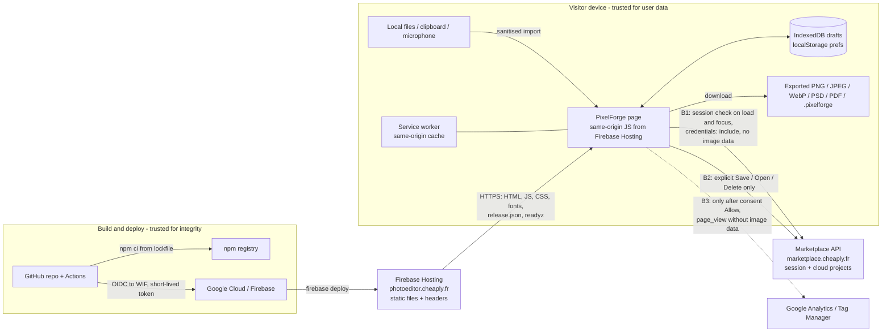

# Security and privacy

PixelForge is a static, local-first web app. Images are decoded, edited and
exported in the visitor's browser; there is no PixelForge application server.
This document describes the threat model, what data leaves the device, and the
controls in the code and hosting configuration. Operational procedures are in
[`operations.md`](operations.md); infrastructure in
[`deployment.md`](deployment.md); file formats in
[`data-formats.md`](data-formats.md); the overall design in
[`architecture.md`](architecture.md). Index: [docs README](README.md).

Statements below are tied to source files. When you change one of those files,
update this document in the same PR.

## Reporting a vulnerability

- Use **GitHub private vulnerability reporting**: repository
  **Security → Report a vulnerability** on
  `cheaply-fr/pixelforge-photo-editor` (enabled on the repository). This opens
  a private security advisory visible only to maintainers.
- Do **not** open a public issue or PR for an unfixed vulnerability, and do
  not attach private images, cookies or tokens to a report.
- There is no `SECURITY.md` and no dedicated security mailbox in this
  repository; the advisory is the channel.

Include the affected URL or file, the deployed version from
`https://photoeditor.cheaply.fr/release.json`, reproduction steps with a
synthetic test file, and impact.

## Threat model

### Assets

| Asset | Where it lives | Sensitivity |
| --- | --- | --- |
| User images, drafts, undo history, File Info (title/description/author), audio notes | Browser: IndexedDB, `sessionStorage` (transient), memory | High: private content, may contain faces, documents, location in source EXIF |
| Cloud projects (opt-in) | Marketplace backend, private EU bucket (see [`deployment.md`](deployment.md)) | High |
| Marketplace session cookie | Browser cookie jar, host-only and HttpOnly on `marketplace.cheaply.fr` | High: account access |
| Preferences (toolbar layout, shortcuts, last filter, actions, analytics consent) | `localStorage` | Low |
| Production site content | Firebase Hosting site `photoeditor-cheaply` | High integrity: a tampered bundle sees every image |
| Deploy capability | GitHub Actions `deploy` job + Google Workload Identity Federation | High |
| Source and dependency supply chain | GitHub repository, npm registry, `package-lock.json` | High integrity |

### Actors

| Actor | Capability | Main concern |
| --- | --- | --- |
| Anonymous visitor | Uses the editor with no account | Their images must stay local |
| Signed-in member | Additionally saves to / opens from cloud projects | Only explicit saves upload; no cross-account access |
| Malicious file author | Supplies an image, SVG, PSD, TIFF, PDF, `.pixelforge` project, action or preset file | Script execution, network exfiltration, resource exhaustion (memory/CPU), corrupting drafts |
| Malicious web page | Can link to, frame or `postMessage` the editor | Clickjacking, CSRF against cloud API, data theft |
| Network attacker | On-path between browser and hosts | Tampering or eavesdropping |
| Compromised dependency or Action | Code running at build or deploy time | Injecting code into the bundle, stealing deploy credentials |
| Contributor / PR author | Opens PRs (including from forks) | Getting unreviewed code deployed, reading secrets from CI |
| Third-party services (Google Analytics, Marketplace) | Receive requests from the browser | Over-collection of data |

### Trust boundaries



Trust decisions:

- Everything inside **Device** is the user's. The editor treats imported files
  as untrusted input until the format decoders and validators accept them.
- **Hosting** is trusted for integrity: it serves the code that handles every
  image. The supply chain protecting it is therefore part of the privacy
  boundary.
- **Marketplace** is trusted with cloud projects only after an explicit user
  action, and its responses are validated before use (`src/cloud.ts`).
- **Google Analytics** is untrusted with content: it never receives images,
  file names, project data or File Info.

## What leaves the device

| Flow | Trigger | Destination | Data sent | Source |
| --- | --- | --- | --- | --- |
| Static app download | Visiting the site | `photoeditor.cheaply.fr` (Firebase Hosting) | Standard HTTP request metadata (IP, user agent, URL) | `firebase.json` |
| Release status poll | Editor open; every 30 s | Same origin `/release.json`, `/api/readyz.json` | Cache-busting `?status=<timestamp>` only | `src/ReleaseStatusView.tsx` |
| Font files | Using a library font | Same origin `/fonts/**` | URL of the font | `public/sw.js`, `src/GlyphsPanel.tsx` |
| **Session check** | Home page and editor load, and on every window focus | `https://marketplace.cheaply.fr/marketplace/api/photoeditor?action=session` with `credentials: 'include'` | The Marketplace cookie if the browser has one; no image or document data | `src/cloud.ts` `useMember` |
| Cloud project list / open / save / delete | User clicks the corresponding action while signed in | Same Marketplace API | Save sends the validated draft document (pixels, layers, history) with File Info **stripped**; delete/open send project id and generation | `src/cloud.ts`, `app/page.tsx`, [`cloud-conflict-contract.md`](cloud-conflict-contract.md) |
| Sign-in, sign-out, profile | User follows the account link | Marketplace pages (top-level navigation) | Normal navigation | `src/cloud.ts`, `src/AccountMenu.tsx` |
| Analytics | **Only after the visitor chooses Allow**, and only if the build has a GA4 measurement ID | `www.googletagmanager.com` (script), `*.google-analytics.com` (collect) | One `page_view` with `app_name: cheaply-pixelforge` and `page_location` = the origin only (no path, no draft id); Google signals and ad personalisation disabled, ad storage denied | `src/Analytics.tsx`, [`analytics.md`](analytics.md) |
| Outbound links | User clicks | e.g. `www.cheaply.fr` | Normal navigation | `src/HomePage.tsx` |

Not sent anywhere:

- Imported images, clipboard images, drafts, undo history, audio notes,
  exports and file names (except a cloud save the user requested).
- File Info title, description and author: kept in the local draft and the
  `.pixelforge` file only, and stripped from cloud envelopes
  ([`metadata-privacy-contract.md`](metadata-privacy-contract.md)).
- **"AI" features are local approximations.** Generate Image
  (`src/generateImage.ts`), Generative Upscale (`src/generativeUpscale.ts`),
  Prompt to Edit (`src/promptToEdit.ts`) and Background Removal
  (`src/backgroundRemoval.ts`) run deterministic in-browser code and never
  call a model or provider. Prompts stay on the device.
- No third-party fonts, CDNs or embeds: `font-src 'self'` and the font
  library is self-hosted under `/fonts/`.

Privacy note on the session check: because it runs on every load and focus,
a visitor who has a Marketplace cookie reveals to Marketplace that they opened
PixelForge, even without using cloud features. It carries no editor content.

## Content Security Policy and headers

Set for every path (`"source": "**"`) in `firebase.json`:

```text
default-src 'self';
script-src 'self' https://www.googletagmanager.com;
style-src 'self' 'unsafe-inline';
img-src 'self' data: blob:;
media-src 'self' data: blob:;
font-src 'self';
connect-src 'self' https://marketplace.cheaply.fr https://www.google-analytics.com https://analytics.google.com https://region1.google-analytics.com;
object-src 'none';
base-uri 'self';
frame-ancestors 'self' https://*.cheaply.fr;
form-action 'self'
```

| Directive | Effect |
| --- | --- |
| `script-src` | No inline scripts, no `eval`; only same-origin bundles and the GA loader. A hostile SVG or project file cannot run script even if it reached the DOM |
| `connect-src` | `fetch`/XHR can reach only the site, Marketplace and GA collection hosts. This is the hard backstop for "images do not leave the device": a bug or a compromised in-page library cannot post data to an arbitrary host |
| `img-src` / `media-src` | Only same-origin, `data:` and `blob:`; imported SVG cannot pull remote images |
| `style-src 'unsafe-inline'` | Needed for runtime inline styles (e.g. the consent banner, canvas UI). Accepted risk: CSS injection could restyle the page but cannot fetch remote resources other than through the directives above |
| `frame-ancestors` | Only same origin and `*.cheaply.fr` may frame the editor (clickjacking defence) |
| `object-src 'none'`, `base-uri 'self'`, `form-action 'self'` | Block plugins, base-tag hijacking and form exfiltration |

Other headers on `**`:

| Header | Value |
| --- | --- |
| `X-Content-Type-Options` | `nosniff` |
| `Referrer-Policy` | `strict-origin-when-cross-origin` |
| `Permissions-Policy` | `camera=(), microphone=(self), geolocation=()` (microphone for audio annotations only) |
| `Strict-Transport-Security` | Added by Firebase Hosting |
| `Cache-Control` | See [`operations.md` → Cache headers](operations.md#7-cache-headers-and-service-worker-updates) |

Changing the CSP: edit `firebase.json`, keep `tests/analytics.test.mjs` /
`tests/font-library.test.mjs` passing (they assert parts of it), and confirm
with `curl -sI https://photoeditor.cheaply.fr/` after deploy. Every new
`connect-src` host is a new place user data could go; justify it in the PR
and update the table above.

## Import hardening

All decoding happens in the browser. Every format has an explicit size bound
and fails closed with a user-visible message; a rejected file leaves the
current draft unchanged.

### Global image bounds

| Limit | Value | Source |
| --- | --- | --- |
| Max width or height | 16,000 px | `src/imageSize.ts` `MAX_IMAGE_DIMENSION` |
| Max pixels | 16,000,000 (16 MP) | `src/imageSize.ts` `MAX_IMAGE_PIXELS` |
| Layers per frame | 512 | `src/projectLimits.ts` |
| Groups per frame | 128 | `src/projectLimits.ts` |
| Assets per project | 4,096 | `src/projectLimits.ts` |
| Stored layer pixels per frame (format ceiling) | 1,024,000,000 | `src/projectLimits.ts` |
| Referenced PNG bytes (format ceiling) | 1 GiB | `src/projectLimits.ts` |
| Device budgets (pixels / asset bytes) | desktop 1,024 M / 1 GiB; standard (≤ 4 GB RAM) 384 M / 384 MiB; mobile 256 M / 256 MiB; low-memory (≤ 2 GB) 128 M / 128 MiB | `src/projectLimits.ts` |

### Per-format rules

| Format | Input bound | What is accepted | What is rejected |
| --- | --- | --- | --- |
| PNG, JPEG, WebP, GIF, AVIF, BMP, APNG | Global pixel bounds | Browser decoder, flattened to a raster layer | Over-size images |
| **SVG** (`src/svg.ts`, `src/svgImport.ts`) | 8 MiB, 20,000 elements, 16,000 px per side, 16 MP | Conservative subset: shapes/text become editable layers; anything else is rasterised from a sanitised standalone SVG. Embedded rasters only as base64 `data:image/(png\|jpeg\|jpg\|gif\|webp)` | `<script>`, `<foreignObject>`, `<iframe>`, `<object>`, `<embed>`, `<audio>`, `<video>`, `<link>`; `on*` event handlers; `javascript:`/`vbscript:` URLs; any `src` attribute; any non-fragment `href`/`xlink:href`/`url()`; `@import`, `@font-face`, CSS `expression()`; DOCTYPE internal subsets/entities; NUL bytes; viewport-relative units; malformed or duplicated root attributes |
| **PSD/PSB** (`src/psd.ts`) | 16,000 px per side, 16 MP; bounds-checked reader (every read checks remaining length) | Flattened 8-bit RGB or grayscale composite, raw or PackBits | Layers, masks, adjustments, profiles (not imported); other depths/modes/compressions; malformed PackBits |
| **TIFF** (`src/tiff.ts`) | 64 MiB, 16,000 px per side, 16 MP | Classic TIFF, 8-bit chunky RGB/RGBA or gray/alpha strips, uncompressed or PackBits | Tiled, planar, palette, CMYK, float, BigTIFF, multipage, other compressions |
| **PDF** (`src/pdf.ts`) | 64 MiB, 16,000 px per side, 16 MP | Only the shape PixelForge exports: one page with one 8-bit DeviceRGB JPEG image | Everything else (vectors, text, fonts, extra pages); PDFs are never handed to a browser PDF viewer |
| HEIC, camera RAW | n/a | Labelled honestly by `src/importFormats.ts` | Not decoded unless the browser can |
| **`.pixelforge` project** (`src/portableBundle.ts`, `src/drafts.ts`) | 1 GiB total, 64 MiB JSON, 80 MiB per asset; project-limit ceilings above | Strict schema validation (`validateDraft`) before anything is installed; File Info limited to 160 / 2,000 / 160 characters with control characters rejected | Unknown keys, malformed or over-limit structures |
| Actions file | 256 KiB | Validated action list | Anything else (`src/actions.ts`) |
| Tool presets | 512 KiB import, 256 KiB stored | Validated presets | (`src/toolPresets.ts`) |
| Clipboard images | Global bounds | PNG, WebP, JPEG, GIF, BMP, AVIF from the OS clipboard, decoded locally | (`src/clipboardImage.ts`) |
| Audio notes | 5 MiB each, 32 MiB per document | Microphone or file, stored locally | (`src/audioAnnotations.ts`) |
| Cloud responses | Project list ≤ 30 entries, ≤ 64 MiB reported size; ids/generations ≤ 160 chars without control characters | Opened documents go through the same `validateDraft` path as project files | Malformed responses fail closed (`src/cloud.ts`) |

React renders file names and text content as text. The only `innerHTML` in
`src/` is the fixed, static consent-banner markup in `src/Analytics.tsx`.

## Export metadata

PNG, JPEG and WebP exports are encoded from a rendered canvas, so they contain
**pixels only**: original EXIF (including GPS), XMP and ICC profiles of the
source file are not copied, and File Info is not embedded
(`src/export.ts`, [`metadata-privacy-contract.md`](metadata-privacy-contract.md)).
PSD and PDF exports are flattened composites written by PixelForge's own
encoders. The `.pixelforge` project file *does* contain File Info, all layers
and the saved undo-history window: treat it as private.

Export size bounds: target-size exports 1 KiB to 64 MiB; batch export 256 MiB
total (`src/export.ts`).

## Storage on the device

| Store | Name / key | Contents | Cleared by |
| --- | --- | --- | --- |
| IndexedDB | `pixelforge-documents` (v2) | Draft manifests, layer/asset blobs, saved history window, cloud link (id, generation, owner) | Discard draft in the editor; browser "Clear site data" |
| IndexedDB | `pixelforge-layer-cache` | Derived layer tiles (performance cache) | Rebuilt as needed; site-data clearing |
| `sessionStorage` | Pending-draft keys (≤ 4 MiB) | Hand-off of a draft across a reload in the same tab | Tab close |
| `localStorage` | `pixelforge:last-draft` | Id of the last draft (for "Continue") | Discard / site-data clearing |
| `localStorage` | `pixelforge.toolbar-*`, `pixelforge.tool-shortcuts`, `pixelforge.command-shortcuts`, `pixelforge.last-filter`, `pixelforge.actions.v1`, … | Preferences | Site-data clearing |
| `localStorage` | `cheaply.analytics.consent.v1` | `granted` / `denied` | Site-data clearing (banner reappears) |
| Cache Storage | `pixelforge-shell-v3`, `pixelforge-fonts-v1` | App shell, hashed assets, fonts, Help pages | Service-worker activation (old shell caches); site-data clearing |
| Cookies (GA, only after Allow) | GA4 cookies, `SameSite=Lax;Secure`, `cookie_domain: none` | Analytics client id | Browser cookie controls |

Drafts survive only in that browser profile. Clearing site data deletes all
local work; there is no server copy unless the user saved to the cloud.

Shared or public computers: anyone with the browser profile can open the
drafts. Users should **Discard draft** and clear site data when done.

## Cloud projects and accounts

- Optional. Anonymous editing never requires sign-in and never uploads.
- Uses the existing Marketplace session (cookie host-only and HttpOnly on
  `marketplace.cheaply.fr`, never readable by PixelForge JS). Requests use
  `credentials: 'include'`, `cache: 'no-store'` and a 30 s timeout.
- Writes are `POST` with `Content-Type: text/plain` (a CORS-simple request);
  per [`deployment.md`](deployment.md) the project API accepts only the exact
  `https://photoeditor.cheaply.fr` origin, which is the CSRF control. That
  server-side check lives in the Marketplace codebase, not here.
- Saves are optimistic-concurrency checked by `generation`; a `409` never
  overwrites local edits ([`cloud-conflict-contract.md`](cloud-conflict-contract.md)).
- Server-side quotas (16 MB per document, 30 projects, 256 MB per library,
  seven-day deletion recovery) are enforced by Marketplace; see
  [`deployment.md`](deployment.md).
- A future central OAuth/OIDC issuer is planned behind a disabled flag
  ([`cheaply-auth-optional.md`](cheaply-auth-optional.md)); it must stay
  optional and use Authorization Code with PKCE.

## Supply chain and dependency policy

| Control | State |
| --- | --- |
| Exact versions | Every `dependencies` and `devDependencies` entry in `package.json` is an exact version (no `^`/`~`) |
| Lockfile | `package-lock.json` is committed; CI and deploy use `npm ci`, which fails on lockfile drift |
| Node | `engines.node >= 22.13.0`; CI uses Node 22 |
| Actions | Third-party Actions pinned to commit SHAs (`checkout`, `setup-node`, `upload-artifact`, `download-artifact`, `google-github-actions/auth`). Exception: `actions/cache@v4` is pinned by tag |
| Deploy tooling | `firebase-tools` is a pinned devDependency invoked with `npx firebase`; Playwright browsers come from the pinned `@playwright/test` |
| Code scanning | GitHub CodeQL default setup on `main` |
| Secret scanning | Enabled, with push protection |
| Dependabot security updates | **Disabled**: dependency updates are manual PRs. Review `npm audit` and GitHub advisories periodically |

Adding a dependency: prefer none; otherwise pin exactly, commit the lockfile,
check its licence and whether it makes network requests (it must fit the CSP
without new hosts), and note it in the PR.

## CI and deployment secrets

- The workflow token is read-only (`permissions: contents: read`). Only the
  `deploy` job gets `id-token: write`, and only that job can obtain cloud
  credentials.
- **No long-lived Google key.** The deploy job exchanges GitHub's OIDC token
  through Workload Identity Federation for short-lived credentials of a
  dedicated deploy service account. The provider condition restricts it to
  this repository's numeric id/owner, `refs/heads/main` and `ci-cd.yml`
  ([`deployment.md`](deployment.md#cicd)). Never broaden the condition or add a
  key to unblock a failing deploy.
- The `production` environment only allows the `main` branch. Pull requests
  (including from forks) run validation only and receive no credentials.
- The GA4 measurement id is public configuration stored as a repository
  *variable*, not a secret, and validated for format before the build.
- Never put credentials, tokens, cookies, personal account details or private
  images in repository files, issues, PRs, logs or chat (see `CLAUDE.md`).
  Use synthetic test images in tests and bug reports.

## Known gaps and accepted risks

| Item | Risk | Status |
| --- | --- | --- |
| `style-src 'unsafe-inline'` | CSS injection impact not fully contained | Accepted; no remote fetch possible beyond `connect-src`/`img-src` |
| No named required status checks on `main` | A PR can be merged with failing checks (deploy still gated) | See [`operations.md`](operations.md#what-main-branch-protection-actually-enforces) |
| Session check on every load/focus | Marketplace learns a signed-in visitor opened PixelForge | Accepted for showing account state; no content sent |
| Navigating to `/health` in a tab controlled by an older service worker | Older `sw.js` builds could store the JSON as the offline `/index.html` | Fixed: `public/sw.js` now bypasses `/health` and `/api/readyz` (see [`offline-pwa.md`](offline-pwa.md)) |
| Dependabot disabled | Slower response to vulnerable dependencies | Manual review |
| Local data at rest | Not encrypted by PixelForge; protected only by the OS/browser profile | Accepted for a local-first app |

## Incident response

1. **Suspected credential exposure** (any token or key in a commit, log or
   chat): revoke/rotate at the provider first, then remove from history if
   required, then review Actions and Firebase audit logs. WIF credentials are
   short-lived, but review the provider and service-account bindings.
2. **Malicious or vulnerable dependency**: pin to a safe version or remove it,
   redeploy through a normal PR; if production is actively serving malicious
   code, roll back first ([`operations.md` → Rollback](operations.md#6-rollback)).
3. **Import parser or CSP bypass**: reproduce with a synthetic file, add a
   failing pure test, fix, deploy, and publish a GitHub security advisory.
4. **Cloud data exposure**: this is a Marketplace backend incident; coordinate
   there. PixelForge-side mitigation is limited to disabling cloud UI paths.

Record the timeline, affected versions (`/release.json` commits) and user
impact in the advisory or incident note.
